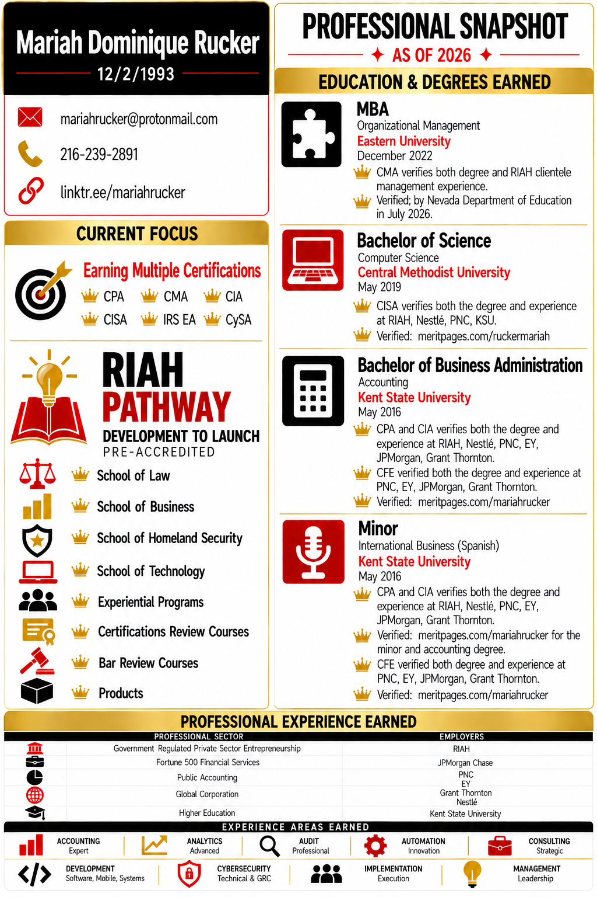
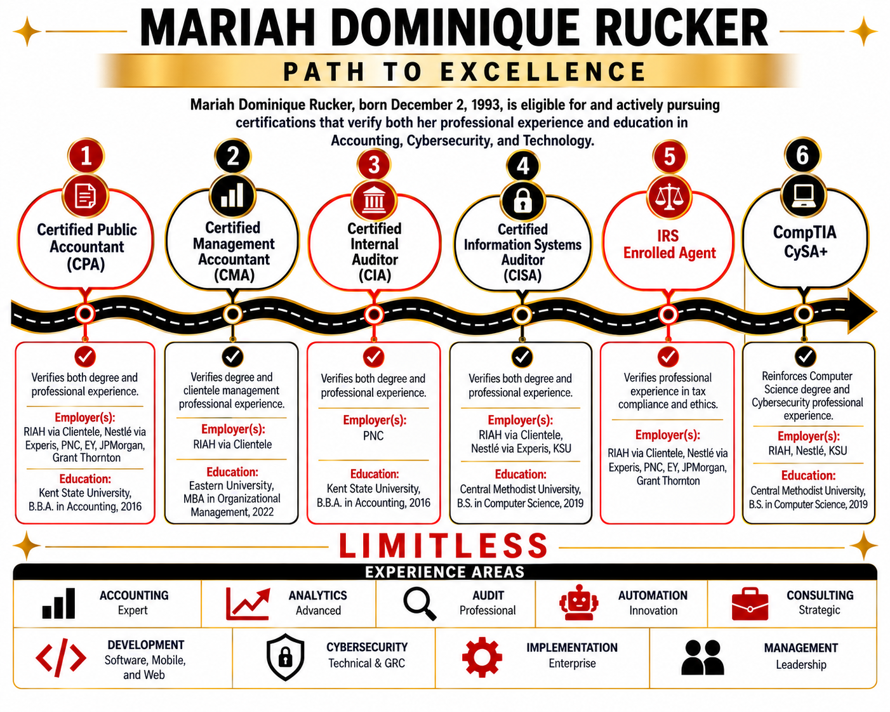
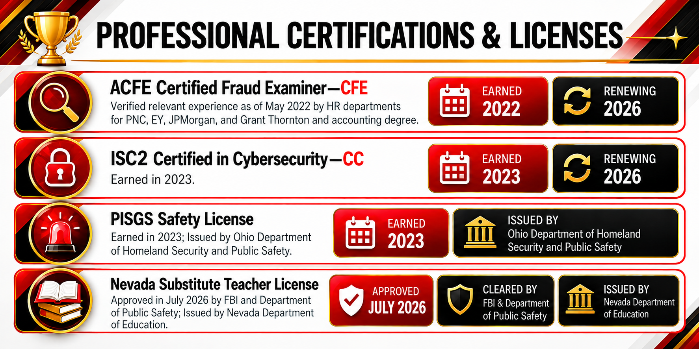
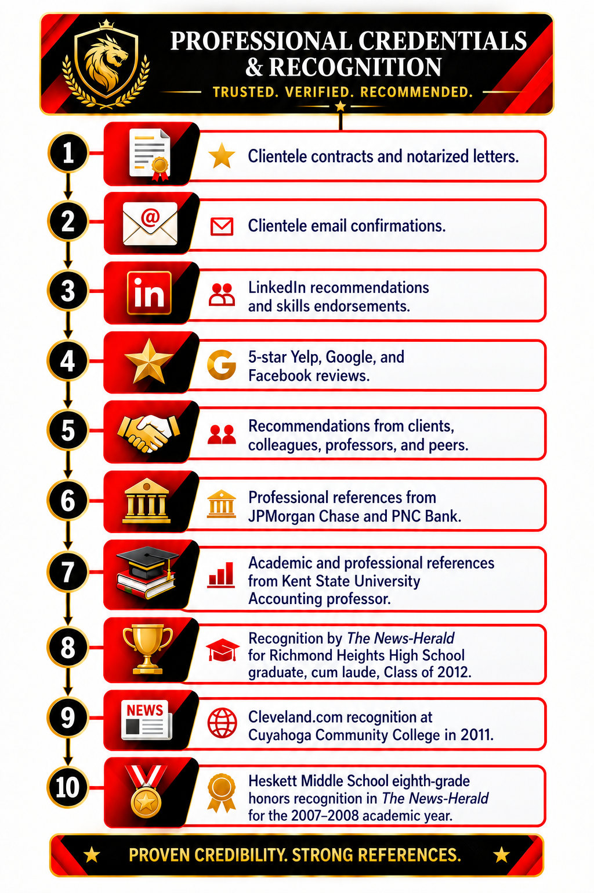

<h1 align="center">👑 Mariah Dominique Rucker Multidisciplinary Professional in Accounting, Cybersecurity, and Technology.</h1>

<strong>Mariah Dominique Rucker</strong>, born <strong>December 2, 1993</strong>, with natural dimples and moles on her face, is a <strong>multidisciplinary professional in Accounting, Cybersecurity, and Technology</strong>. She has more than <strong>10 years of documented education and professional experience</strong>, and is the <strong>Founder/CEO/Chairman of <a href="https://riahpathway.com">RIAH Pathway</a></strong>, building a <strong>connected ecosystem integrating education, real work experience, certifications, products, people, software, and a mobile app</strong>.

---

<h3 align="center">⭐ One Link • Every Credential • Publicly Verifiable ⭐</h3>

<strong><a href="https://linktr.ee/mariahrucker">Portfolio Hub</a></strong>

<strong>Accounting • Cybersecurity • Technology • Education • Experience • Certifications</strong>

---

**RIAH Pathway** is a connected ecosystem integrating education, real work experience, certifications, products, people, software and mobile app.

> **Schools, accreditation & website:** RIAH Pathway is in its **pre-accreditation stage (not yet accredited)** and plans to seek applicable state authorization and program accreditation/recognition, including **ABA, ACCSC, ABET, NSA**, and other relevant bodies. Expansion is planned across **all 50 states and D.C.**. The website releases **by November 2026**. See the [Website Wireframes & Structure](https://github.com/RIAHPathway/Website-Draft/tree/main/RIAH-PATHWAY-WEBSITE-WIREFRAMES-STRUCTURE) folder for information being revised and finalized. **Tuition, fees, and internal/external pricing** for beta pre-accreditation and post-accreditation will be finalized and published at website launch. Beta cohort applications open November 2026 with launch planned for Spring 2027. All curriculum and experientials are 100% remote and proctored with industry professionals from CPA's to Judges to Engineers, except external placements which are either remote, hybrid, or onsite depending on partner employers. Details on the curriculum, tuition, fees, and up to 50% tuition reimbursement with 10% guaranteed will be forthcoming on the website. 

<strong>👤Contributor/Founder/CEO/Chairman: Mariah Dominique Rucker</strong>is building and leading RIAH Pathway.

<h2 align="center">🎓 Education</h2>

<h3 align="center">🔄 In-Progress</h3>

<table align="center">
  <thead>
    <tr>
      <th align="left">Credential</th>
      <th align="left">Field</th>
      <th align="left">Pathway</th>
      <th align="left">Target</th>
    </tr>
  </thead>
  <tbody>
    <tr>
      <td align="left">🔄 Bachelor's</td>
      <td align="left">Finance</td>
      <td align="left">RIAH Pathway</td>
      <td align="left"><strong>2029</strong></td>
    </tr>
    <tr>
      <td align="left">🔄 Bachelor's</td>
      <td align="left">Cybersecurity</td>
      <td align="left">RIAH Pathway</td>
      <td align="left"><strong>2029</strong></td>
    </tr>
    <tr>
      <td align="left">🔄 Bachelor's</td>
      <td align="left">Intelligence</td>
      <td align="left">RIAH Pathway</td>
      <td align="left"><strong>2029</strong></td>
    </tr>
    <tr>
      <td align="left">🔄 JD</td>
      <td align="left">Law</td>
      <td align="left">RIAH Pathway</td>
      <td align="left"><strong>2030</strong></td>
    </tr>
  </tbody>
</table>

<h3 align="center">✅ Earned</h3>

<table align="center">
  <thead>
    <tr>
      <th align="center">Credential</th>
      <th align="center">Field</th>
      <th align="center">Institution</th>
      <th align="center">Year</th>
      <th align="center">Verification</th>
    </tr>
  </thead>
  <tbody>
    <tr>
      <td align="center">✅ MBA</td>
      <td align="center">Organizational Management</td>
      <td align="center">Eastern University</td>
      <td align="center"><strong>2022</strong></td>
      <td align="center">Education verified by the Nevada Board of Education for substitute teaching licensure, July 2026</td>
    </tr>
    <tr>
      <td align="center">✅ B.S.</td>
      <td align="center">Computer Science</td>
      <td align="center">Central Methodist University</td>
      <td align="center"><strong>2019</strong></td>
      <td align="center"><a href="https://meritpages.com/RuckerMariah">Merit Pages</a> • Nevada Board of Education verified, July 2026</td>
    </tr>
    <tr>
      <td align="center">✅ B.B.A.</td>
      <td align="center">Accounting</td>
      <td align="center">Kent State University</td>
      <td align="center"><strong>2016</strong></td>
      <td align="center">
        <a href="https://meritpages.com/MariahRucker">Merit Pages</a> •
        Nevada Board of Education verified, July 2026 •
        <a href="https://youtu.be/gGEnKMVeelc?si=t645mL1-9Hp125UY" target="_blank" rel="noopener noreferrer">2012 Kent State University Graduation Video</a>
      </td>
    </tr>
    <tr>
      <td align="center">✅ Minor</td>
      <td align="center">International Business Spanish</td>
      <td align="center">Kent State University</td>
      <td align="center"><strong>2016</strong></td>
      <td align="center">
        <a href="https://meritpages.com/MariahRucker">Merit Pages</a> •
        Nevada Board of Education verified, July 2026 •
        <a href="https://youtu.be/gGEnKMVeelc?si=t645mL1-9Hp125UY" target="_blank" rel="noopener noreferrer">2012 Kent State University Graduation Video</a>
      </td>
    </tr>
  </tbody>
</table>

<h2 align="center">📚 Professional Certifications</h2>

<table align="center">
  <thead>
    <tr>
      <th align="left">Certification</th>
      <th align="left">Status</th>
    </tr>
  </thead>
  <tbody>
    <tr>
      <td align="left">Certified Fraud Examiner — <strong>CFE</strong></td>
      <td align="left">✅ Earned</td>
    </tr>
    <tr>
      <td align="left">(ISC)² Certified in Cybersecurity — <strong>CC</strong></td>
      <td align="left">✅ Earned</td>
    </tr>
    <tr>
      <td align="left">Certified Public Accountant — <strong>CPA</strong></td>
      <td align="left">🔄 In Progress</td>
    </tr>
    <tr>
      <td align="left">Certified Management Accountant — <strong>CMA</strong></td>
      <td align="left">🔄 In Progress</td>
    </tr>
    <tr>
      <td align="left">Certified Internal Auditor — <strong>CIA</strong></td>
      <td align="left">🔄 In Progress</td>
    </tr>
    <tr>
      <td align="left">Certified Information Systems Auditor — <strong>CISA</strong></td>
      <td align="left">🔄 In Progress</td>
    </tr>
    <tr>
      <td align="left">Certified Information Security Manager — <strong>CISM</strong></td>
      <td align="left">🔄 In Progress</td>
    </tr>
    <tr>
      <td align="left">Certified in Risk and Information Systems Control — <strong>CRISC</strong></td>
      <td align="left">🔄 In Progress</td>
    </tr>
    <tr>
      <td align="left">Certified Information Systems Security Professional — <strong>CISSP</strong></td>
      <td align="left">🔄 In Progress</td>
    </tr>
  </tbody>
</table>

<h2 align="center">💼 Professional Experience</h2>

<table align="center">
  <thead>
    <tr>
      <th align="left">Sector</th>
      <th align="left">Employer</th>
    </tr>
  </thead>
  <tbody>
    <tr>
      <td align="left">💻 Entrepreneurship</td>
      <td align="left"><strong>RIAH</strong></td>
    </tr>
    <tr>
      <td align="left">💳 Financial Services</td>
      <td align="left"><strong>JPMorgan Chase</strong></td>
    </tr>
    <tr>
      <td align="left">💳 Financial Services</td>
      <td align="left"><strong>PNC Bank</strong></td>
    </tr>
    <tr>
      <td align="left">🧮 Public Accounting</td>
      <td align="left"><strong>Ernst &amp; Young</strong></td>
    </tr>
    <tr>
      <td align="left">🧮 Public Accounting</td>
      <td align="left"><strong>Grant Thornton</strong></td>
    </tr>
    <tr>
      <td align="left">🏢 Global Corporation</td>
      <td align="left"><strong>Nestlé</strong></td>
    </tr>
    <tr>
      <td align="left">🎓 Higher Education</td>
      <td align="left"><strong>Kent State University</strong></td>
    </tr>
  </tbody>
</table>

<h2 align="center">🧠 Areas of Experience</h2>

<table align="center">
  <thead>
    <tr>
      <th align="left">Business &amp; Finance</th>
      <th align="left">Technology</th>
      <th align="left">Professional</th>
    </tr>
  </thead>
  <tbody>
    <tr>
      <td align="left">🧮 Accounting</td>
      <td align="left">🔐 Cybersecurity</td>
      <td align="left">💼 Consulting</td>
    </tr>
    <tr>
      <td align="left">🔍 Audit</td>
      <td align="left">💻 Technology</td>
      <td align="left">👥 Management</td>
    </tr>
    <tr>
      <td align="left">📈 Analytics</td>
      <td align="left">🤖 Automation</td>
      <td align="left">🎓 Higher Education</td>
    </tr>
    <tr>
      <td align="left">💳 Financial Services</td>
      <td align="left">💻 Development</td>
      <td align="left">💻 Entrepreneurship</td>
    </tr>
    <tr>
      <td align="left">🧮 Public Accounting</td>
      <td align="left">⚙️ Implementation</td>
      <td align="left">🏢 Business Operations</td>
    </tr>
  </tbody>
</table>

---

<table align="center">
  <thead>
    <tr>
      <th align="center">Social</th>
      <th align="center">Full Link</th>
    </tr>
  </thead>
  <tbody>
    <tr>
      <td align="center">🌳 <strong>Linktree</strong></td>
      <td align="center"><a href="https://linktr.ee/mariahrucker">https://linktr.ee/mariahrucker</a></td>
    </tr>
    <tr>
      <td align="center">📅 <strong>Calendly</strong></td>
      <td align="center"><a href="https://calendly.com/mariahdominiquerucker/30min">https://calendly.com/mariahdominiquerucker/30min</a></td>
    </tr>
    <tr>
      <td align="center">💻 <strong>GitHub</strong></td>
      <td align="center"><a href="https://github.com/mariahdominiquerucker">https://github.com/mariahdominiquerucker</a></td>
    </tr>
    <tr>
      <td align="center">💼 <strong>LinkedIn</strong></td>
      <td align="center"><a href="https://linkedin.com/in/mariahrucker">https://linkedin.com/in/mariahrucker</a></td>
    </tr>
    <tr>
      <td align="center">📘 <strong>Facebook</strong></td>
      <td align="center"><a href="https://facebook.com/heymariahrucker">https://facebook.com/heymariahrucker</a></td>
    </tr>
    <tr>
      <td align="center">📸 <strong>Instagram</strong></td>
      <td align="center"><a href="https://instagram.com/heymariahrucker">https://instagram.com/heymariahrucker</a></td>
    </tr>
    <tr>
      <td align="center">▶️ <strong>YouTube</strong></td>
      <td align="center"><a href="https://youtube.com/@mariahrucker">https://youtube.com/@mariahrucker</a></td>
    </tr>
    <tr>
      <td align="center">💡 <strong>LeetCode</strong></td>
      <td align="center"><a href="https://leetcode.com/u/mariahrucker/">https://leetcode.com/u/mariahrucker/</a></td>
    </tr>
  </tbody>
</table>

---

<h2 align="center">Professional Resume</h2>

Mariah’s <strong>professional resumes</strong> documents her multidisciplinary background across <strong>Accounting, Cybersecurity, and Technology</strong>.

<table align="center">
  <thead>
    <tr>
      <th align="center">Resume</th>
      <th align="center">Full Link</th>
    </tr>
  </thead>
  <tbody>
    <tr>
      <td align="center">🧮 <strong>Accounting Resume</strong></td>
      <td align="center"><a href="https://drive.google.com/drive/folders/1fbKeevwA7rFtSYHoUY5abxUdlGq3_JAH">https://drive.google.com/drive/folders/1fbKeevwA7rFtSYHoUY5abxUdlGq3_JAH</a></td>
    </tr>
    <tr>
      <td align="center">💻 <strong>Cybersecurity and Technology Resume</strong></td>
      <td align="center"><a href="https://drive.google.com/drive/folders/1fbKeevwA7rFtSYHoUY5abxUdlGq3_JAH">https://drive.google.com/drive/folders/1fbKeevwA7rFtSYHoUY5abxUdlGq3_JAH</a></td>
    </tr>
  </tbody>
</table>

<h2 align="center">🎶 Pathway to Success by RIAH Pathway</h2>

  

---

<h2 align="center">Professional Certifications</h2>

Mariah’s <strong>professional certifications</strong> include credentials in <strong>Cybersecurity and Fraud Examination</strong>, with verification available through <strong>Credly</strong>.

<table align="center">
  <thead>
    <tr>
      <th align="center">Professional Certification</th>
      <th align="center">Issued and Verification</th>
      <th align="center">Full Link</th>
    </tr>
  </thead>
  <tbody>
    <tr>
      <td align="center">🏅 <strong>International Information System Security Certification Consortium Certified in Cybersecurity</strong></td>
      <td align="center"><strong>Issued August 2023</strong> • <strong>Credly Verified</strong></td>
      <td align="center"><a href="https://www.credly.com/badges/d250fe79-7c93-4598-b854-51ba240018c9">https://www.credly.com/badges/d250fe79-7c93-4598-b854-51ba240018c9</a></td>
    </tr>
    <tr>
      <td align="center">🔍 <strong>Certified Fraud Examiner</strong></td>
      <td align="center"><strong>Issued May 2022</strong> • Association of Certified Fraud Examiners Verified Relevant Experience at <strong>PNC Bank, Ernst and Young, JPMorgan Chase, and Grant Thornton</strong> • <strong>Credly Verified</strong></td>
      <td align="center"><a href="https://www.credly.com/badges/475a306b-ae15-4130-8c89-2ae0bfa0b25b">https://www.credly.com/badges/475a306b-ae15-4130-8c89-2ae0bfa0b25b</a></td>
    </tr>
  </tbody>
</table>

---

<h2 align="center">Professional Licenses</h2>

Mariah’s <strong>professional licenses</strong> include credentials issued or verified through government agencies in <strong>Nevada and Ohio</strong>.

<table align="center">
  <thead>
    <tr>
      <th align="center">Professional License</th>
      <th align="center">License Information</th>
      <th align="center">Full Link</th>
    </tr>
  </thead>
  <tbody>
    <tr>
      <td align="center">🍎 <strong>Nevada Substitute Teacher License Number 241907 or 12/2/1993 DOB</strong></td>
      <td align="center"><strong>2026–2031</strong> • Nevada Department of Education Verified All Degrees in <strong>Accounting, Computer Science, and Master of Business Administration</strong>.</td>
      <td align="center"><a href="https://online.nvdoe.org/#/VerifyLicense">https://online.nvdoe.org/#/VerifyLicense</a></td>
    </tr>
    <tr>
      <td align="center">🛡️ <strong>Ohio Homeland Security Private Investigator Security Guard Services License</strong></td>
      <td align="center"><strong>2023–2026</strong></td>
      <td align="center"><a href="https://services.dps.ohio.gov/PISGS/mvc/Registrant/Detail/20231100514279_1988_A_2026-11-15">https://services.dps.ohio.gov/PISGS/mvc/Registrant/Detail/20231100514279_1988_A_2026-11-15</a></td>
    </tr>
  </tbody>
</table>

---

<h2 align="center">Professional Recognition</h2>

Mariah’s <strong>accomplishments</strong> are supported by documented references and recognition, including:

<table align="center">
  <thead>
    <tr>
      <th align="center">Professional Recognition</th>
      <th align="center">Full Link</th>
    </tr>
  </thead>
  <tbody>
    <tr>
      <td align="center">🎓 <strong>Richmond Heights High School, Class of 2012</strong></td>
      <td align="center"><a href="https://www.news-herald.com/2012/06/05/graduation-2012-richmond-heights-high-school-2">https://www.news-herald.com/2012/06/05/graduation-2012-richmond-heights-high-school-2</a></td>
    </tr>
    <tr>
      <td align="center">✨ <strong>Cuyahoga Community College, 2011 News Feature</strong></td>
      <td align="center"><a href="https://www.cleveland.com/metro/2011/04/central_state_university_deter.html">https://www.cleveland.com/metro/2011/04/central_state_university_deter.html</a></td>
    </tr>
    <tr>
      <td align="center">🏆 <strong>Heskett Middle School, 2008 Honor Roll</strong></td>
      <td align="center"><a href="https://www.cleveland.com/bedfordsunbanner/2008/03/hnor_roll_heskett_middle_scho.html">https://www.cleveland.com/bedfordsunbanner/2008/03/hnor_roll_heskett_middle_scho.html</a></td>
    </tr>
    <tr>
      <td align="center">🏆 <strong>Heskett Middle School, 2007 Honor Roll</strong></td>
      <td align="center"><a href="https://www.cleveland.com/bedfordsunbanner/2007/12/honor_roll_heskett_middle_scho.html">https://www.cleveland.com/bedfordsunbanner/2007/12/honor_roll_heskett_middle_scho.html</a></td>
    </tr>
  </tbody>
</table>
